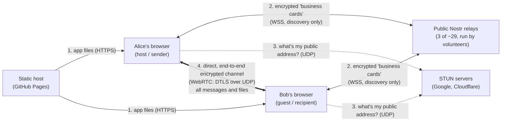
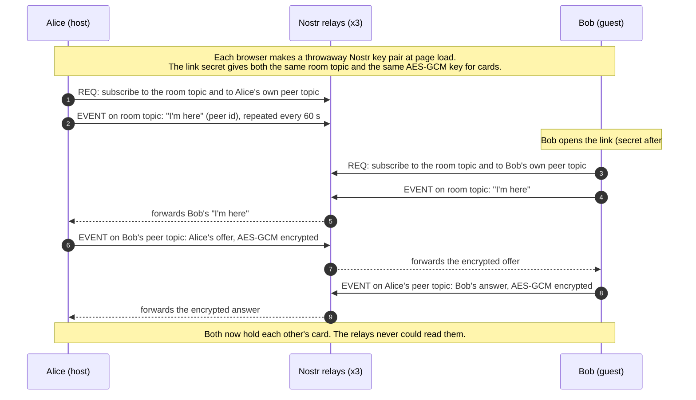
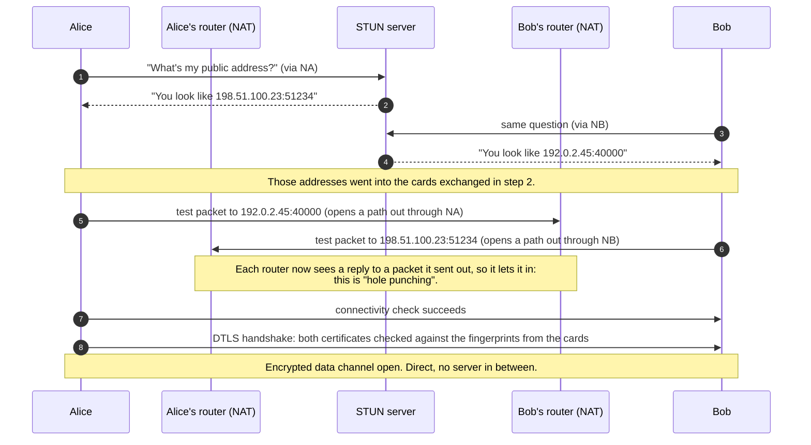
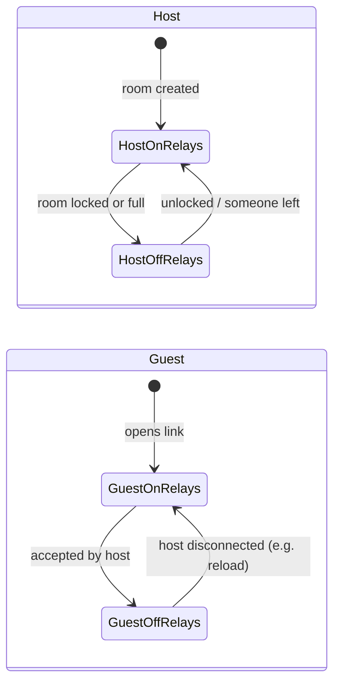
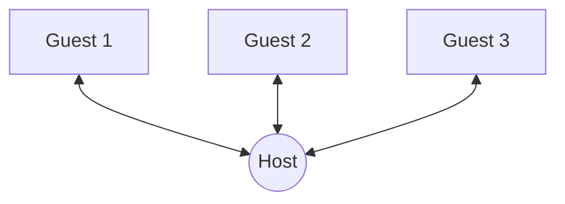

# How two browsers find each other and connect

This document explains, step by step, how Secure Share and Secure Chat get two browsers talking
directly, without a server of ours in between. No prior networking knowledge is assumed. The
decisions behind each choice are in [DECISIONS.md](DECISIONS.md), and the exact cryptographic
messages are in [PROTOCOL.md](PROTOCOL.md).

## The big picture



| Who | Sees | Never sees |
|---|---|---|
| Static host | That someone loaded the app; your IP | The room link's secret (the `#…` part is never sent), anything you share |
| Nostr relays | Your IP, timing, an opaque topic, encrypted connection offers | Who you are, the passphrase, any message or file |
| STUN servers | Your public IP and port | Anything else |
| The other browser | Your IP address (inherent to a direct connection) | Nothing it isn't meant to; you approve who joins |

## Step 1: the problem, two browsers behind NATs

Almost every device sits behind a router doing **NAT**: the device can call out to the internet,
but nothing can call *in* unless the device opened that path first. A device doesn't even know its
own public address. So two browsers can't simply connect to each other.

**WebRTC** is the browser feature for direct browser-to-browser connections. To use it, each side
must give the other a "business card", called an **SDP** (Session Description), containing:

| On the card | What it's for |
|---|---|
| **Candidates**: addresses where I might be reachable (local IP, public IP:port) | Where to aim |
| **ICE credentials**: a short username and password for the connection checks | So stray traffic is ignored |
| **DTLS fingerprint**: a hash of my encryption certificate | So the other side knows it's really me (our safety codes are built from these) |

One side writes an **offer**, the other replies with an **answer**. WebRTC deliberately doesn't
say *how* these cards are delivered. That part is called **signaling**, and it's where Nostr comes in.

## Step 2: finding each other through Nostr relays (signaling)

**Nostr** is an open protocol made of two things:
- **Relays**: simple WebSocket servers that anyone can run, with hundreds of public, free ones.
  They accept messages and forward them to whoever subscribed. Relays don't talk to each other,
  so a client uses several for redundancy.
- **Events**: the only message type, a small signed JSON object:

```json
{ "id": "<sha256 of the fields below>",
  "pubkey": "<author's public key>",
  "created_at": 1791700000,
  "kind": 24187,
  "tags": [["x", "<topic>"]],
  "content": "<here: an encrypted business card>",
  "sig": "<Schnorr signature (secp256k1) by pubkey>" }
```

There are three operations: `EVENT` (publish), `REQ` (subscribe with a filter, e.g. "events of
kind K tagged x = T, from now on") and `CLOSE` (unsubscribe). **Kinds 20000–29999 are
*ephemeral*:** relays pass them on to current subscribers and **don't store them**. That's the part
of Nostr meant for live, throwaway messages like ours.

[Trystero](https://github.com/dmotz/trystero), the library we use, turns this into a meeting place:



- The key that encrypts the cards is `SHA-256(password : appId : roomId)`, where our "password"
  is a random 256-bit value **derived from the link secret, never from your passphrase**. A relay
  can't decrypt the cards, and nothing on the relay helps guess the passphrase offline.
- The topics and event kind are derived from the app name and the room ID, so only browsers with
  the same link meet.

## Step 3: punching through the NATs (ICE, STUN)



- **STUN** only tells each browser its public address. It never sees any data.
- This works for most home, office and mobile networks: it was tested with an iPhone on 5G
  against a computer on wifi.
- It fails when **both** sides are behind *symmetric* NATs (some corporate networks). That would
  need a **TURN** relay to carry the traffic, which we deliberately don't run. See
  [DECISIONS.md](DECISIONS.md).

## Step 4: our own checks, inside the direct channel

Once the WebRTC channel is open, the app runs its own protocol before anything is shared
(details in [PROTOCOL.md](PROTOCOL.md)):

```mermaid
sequenceDiagram
    autonumber
    participant A as Alice (host)
    participant B as Bob (guest)
    A->>B: hello: host public key + fresh number
    B->>A: hello: guest public key + fresh number + nickname
    Note over B: Bob checks Alice's key against the fingerprint in the link.<br/>Otherwise she isn't the host, so he stops.
    A->>B: signature over both fresh numbers (proves Alice holds the host key)
    B->>A: passphrase proof (HMAC over both fresh numbers; reveals nothing reusable)
    Note over A: Wrong proof means "wrong passphrase"; 5 failures lock the room
    A->>B: ok
    Note over A,B: Both screens show the same safety code (from both DTLS certificates).<br/>Chat: Alice approves Bob. Share: delivery starts.
    A->>B: messages / files: signed by the sender, AES-256-GCM encrypted
```

## Step 5: leaving the relays

The relays are only needed so that **new** peers can find the room. As soon as that's no longer
true, the app closes its relay connections and stops Trystero from reconnecting:



The direct WebRTC channel doesn't use the relays, so chatting and file transfer continue with zero
relay connections.

## Chat with several people: a star through the host



Guests connect **only to the host**, never to each other, so they never learn each other's IP
addresses. The host relays each message unchanged. The sender's signature travels with it, so the
host can't alter or forge it.

## How the tests reproduce this

| Test | Signaling | NAT traversal | Network |
|---|---|---|---|
| Unit (`test-unit`) | In-memory fake of Trystero | None (fake transport) | None |
| End-to-end (`test-e2e`) | A minimal Nostr relay inside the test server (`tests/e2e/server.py`, same origin) | Host candidates only (no STUN) | Local only |
| End-to-end, public (`test-e2e-public`) | The real public Nostr relays | Real STUN | Internet |

The e2e tests point the app at the local relay through a test-only hook
(`globalThis.__USS_TEST_RELAYS__`). A link or user input can't set it: only a script that already
runs in the page, and so already controls it, can.

## Alternatives for signaling (summary)

| Option | What it is | Status |
|---|---|---|
| **Public Nostr relays** (via Trystero) | Many independent, free relays; ephemeral events | **Current** |
| BitTorrent WebSocket trackers | Built for WebTorrent peer discovery | Fewer public trackers survive; fragile |
| Public MQTT brokers | IoT pub/sub, mostly test brokers | A few companies, meant for testing |
| Firebase / Supabase | Hosted database | Needs an account; one company |
| **Our own signaling relay** | A small server we run (Trystero `ws-relay`, or a Nostr relay limited to our events) | Proposed, see [IDEAS.md](IDEAS.md#own-signaling-relay) |

Our own relay would only carry the encrypted cards (a few KB per connection). Data would still go
directly between browsers.
