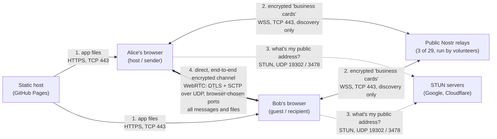
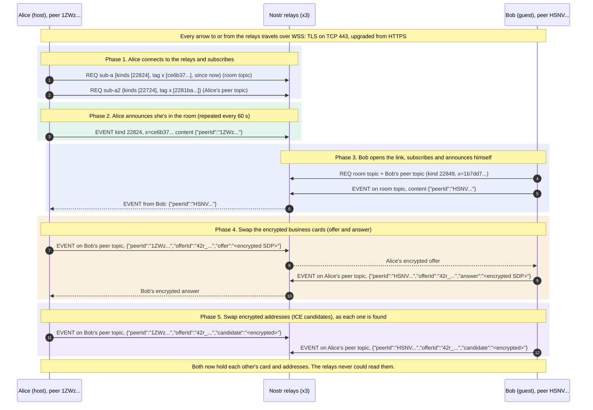
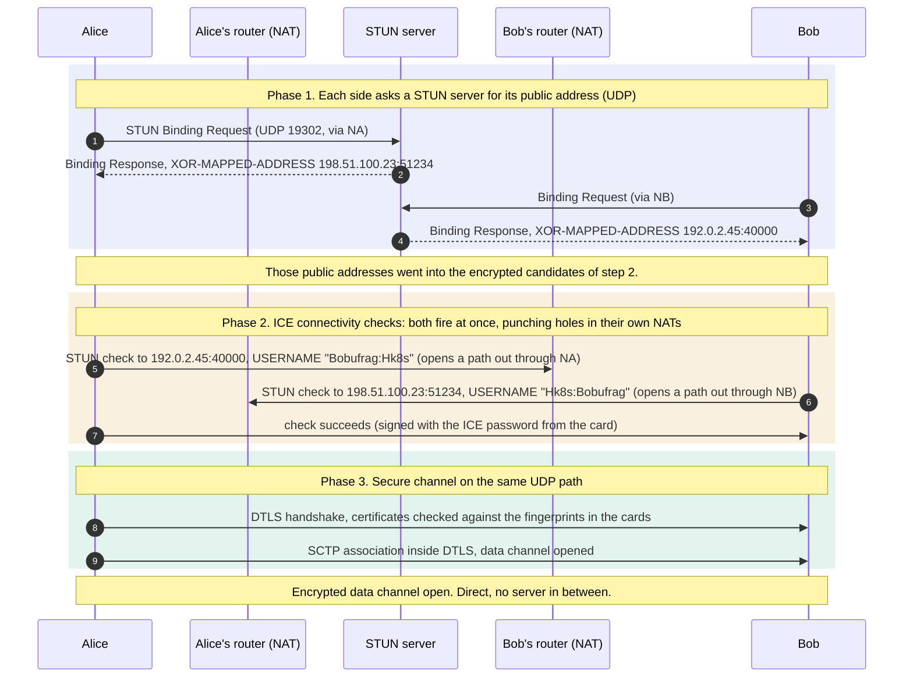
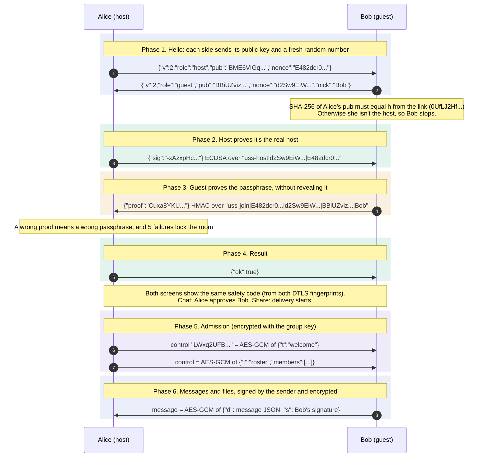
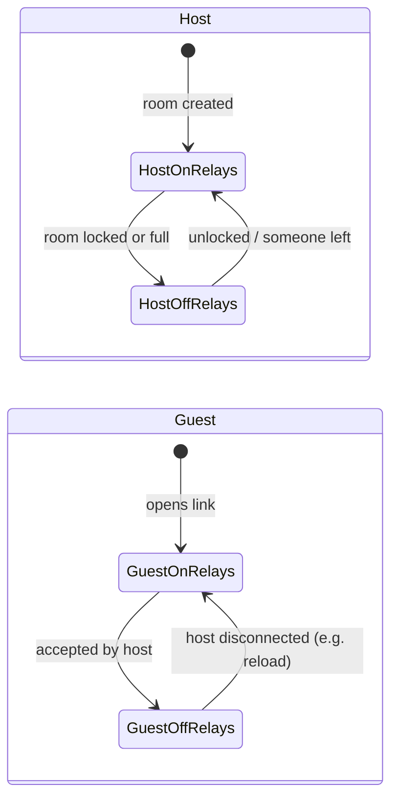
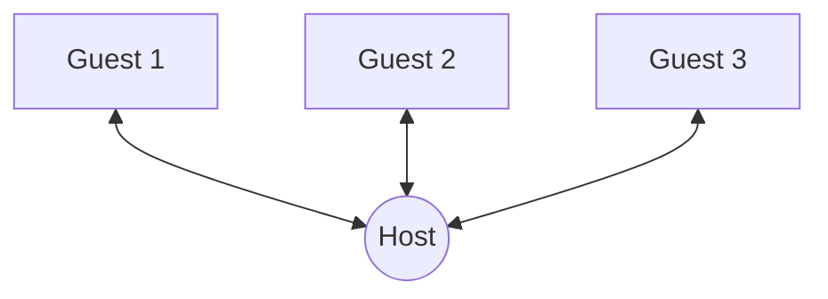

# How two browsers find each other and connect

This document explains, step by step, how Secure Share and Secure Chat get two browsers talking
directly, without a server of ours in between. No prior networking knowledge is assumed. The
decisions behind each choice are in [DECISIONS.md](DECISIONS.md), and the exact cryptographic
messages are in [PROTOCOL.md](PROTOCOL.md).

**About the examples:** every message below has the exact *format* the app and Trystero use:
field names, encodings and lengths. The *values* are made up (random), except where marked as
real (relay host names, STUN servers, the topic computation). Public IP addresses come from the
ranges reserved for documentation (RFC 5737), so none belongs to a real network.

## The big picture



| Who | Sees | Never sees |
|---|---|---|
| Static host | That someone loaded the app; your IP | The room link's secret (the `#…` part is never sent), anything you share |
| Nostr relays | Your IP, timing, an opaque topic, encrypted connection offers | Who you are, the passphrase, any message or file |
| STUN servers | Your public IP and port | Anything else |
| The other browser | Your IP address (inherent to a direct connection) | Nothing it isn't meant to; you approve who joins |

All of the app's code, including the Trystero library, comes from the static host. Nothing is
loaded from any other site (since 0.6.0).

## Step 0: the room link and the passphrase

Creating a room makes three random values and puts them in the link, **after the `#`**. Browsers
never send that part of a URL to any server, not even to the site that serves the app.

```
https://share.common-sec.org/#/share?r=Q7nmLtvgH6OIiTJ387mbqQ&k=G4laNCs8p9dVdjEwUSRZZ8tAwBdv-cH4tTxzRKiO1nY&h=0UfLJ2Hfxmyl2PblVEoHTrbRx_1MUl2F5lyU-gJIVdY
└─── sent to the server ────┘└─────────────────────── stays in the browser ───────────────────────────────────────────────────────────────┘
```

| Parameter | Example | What it is | Used for |
|---|---|---|---|
| `#/share` or `#/chat` | `#/share` | Which tool | Picks the screen, and the Trystero app ID: `user-sec-tools.share.v2` or `user-sec-tools.chat.v2` (the project's original name, kept on purpose: changing it would split peers, see [PROTOCOL.md §3](PROTOCOL.md)) |
| `r`: room ID | `Q7nmLtvgH6OIiTJ387mbqQ` | 16 random bytes, base64url (22 chars) | Names the room: the Nostr topics and key-derivation salts come from it |
| `k`: link secret | `G4laNCs8…KiO1nY` | 32 random bytes, base64url (43 chars) | Encrypts the business cards on the relays, and, with the passphrase, all data |
| `h`: host key fingerprint | `0UfLJ2Hf…gJIVdY` | SHA-256 of the host's public key (43 chars) | Lets guests check they reached the real host |

| Not in the link | Example | What it is |
|---|---|---|
| **Passphrase** | `ginger mule honey hen wizard lotus` (an example: never use a published passphrase) | Shared separately (e.g. read out on a call). Proven inside the direct channel; never sent anywhere |
| Host public key | `BME6VIGq4d4D2PcV…0PhwAAE` (87 chars) | The host's ECDSA P-256 public key, sent in the handshake (step 4). Its SHA-256 must equal `h` |

What's derived from them ([PROTOCOL.md §2](PROTOCOL.md)):

```
signaling password = HKDF(k, salt "uss/v2/" + r, info "signaling")   → given to Trystero (step 2)
group key, auth key = HKDF(k ‖ PBKDF2(passphrase, 600 000 rounds), …) → our own encryption (step 4)
```

## Step 1: the problem, two browsers behind NATs

Almost every device sits behind a router doing **NAT**: the device can call out to the internet,
but nothing can call *in* unless the device opened that path first. A device doesn't even know its
own public address. So two browsers can't simply connect to each other.

**WebRTC** is the browser feature for direct browser-to-browser connections. To use it, each side
must give the other a "business card", called an **SDP** (Session Description). This is a
shortened real one, for a data channel like ours:

```
v=0
o=- 4611731400430051336 2 IN IP4 127.0.0.1
s=-
t=0 0
a=group:BUNDLE 0
m=application 9 UDP/DTLS/SCTP webrtc-datachannel        ← "I want a data channel over DTLS/UDP"
c=IN IP4 0.0.0.0
a=ice-ufrag:Hk8s                                          ← ICE username for connection checks
a=ice-pwd:3nZq9c0Yt8sWm2pLx4RkVb7e                        ← ICE password for connection checks
a=ice-options:trickle                                     ← addresses will follow separately
a=fingerprint:sha-256 B2:41:7C:1F:03:82:24:85:8A:A1:D2:EB:24:6D:36:F3:3C:5D:26:38:5A:5F:B0:B5:E8:D5:C4:C8:07:E2:2F:5B
a=setup:actpass                                           ← DTLS role (client or server) negotiable
a=mid:0
a=sctp-port:5000
a=max-message-size:262144
```

The addresses (**candidates**) are sent separately as they're discovered ("trickle ICE"):

```
candidate:1840965416 1 udp 2122260223 4f1c2a9e-6b3d-4e7a-9c10-2d8e5f7a1b3c.local 54321 typ host generation 0 ufrag Hk8s
candidate:842163049 1 udp 1686052607 198.51.100.23 51234 typ srflx raddr 0.0.0.0 rport 0 generation 0 ufrag Hk8s
```

- `typ host`: the device's own address. Browsers hide local IPs behind a random `.local` name (mDNS).
- `typ srflx` ("server reflexive"): the **public** address the NAT gave us, as seen by a STUN server (step 3).
- The fingerprint is the hash of the browser's DTLS certificate. Our safety codes are computed
  from both sides' fingerprints.

WebRTC deliberately doesn't say how these cards are delivered. That part is called **signaling**.

## Step 2: finding each other through Nostr relays (signaling)

### Nostr in one minute

**Nostr** is an open protocol made of two things:
- **Relays**: simple WebSocket servers that anyone can run, with hundreds of public, free ones.
  They accept messages and forward them to whoever subscribed. Relays don't talk to each other,
  so a client uses several for redundancy.
- **Events**: the only message type, a small signed JSON object (exact fields from the Nostr spec, NIP-01):

```json
{ "id": "27a13171feb2de3a489dba399b8d6a31aa197e7b62633c733f2657ee4d551878",
  "pubkey": "2a83950b22a552e47c4b621c19bc07cc6a26711118be867d5fa7f25b1823e157",
  "created_at": 1791700000,
  "kind": 22824,
  "tags": [["x", "ce6b3751177551996a09cc9e67de61f224fa5ffe"]],
  "content": "{\"peerId\":\"1ZWzQtkzeNWT740wEGd4\",\"nonce\":\"Xq3Lk9Pz\"}",
  "sig": "983213f22fd61a4fc79037862650e46bed18deec…(128 hex chars)" }
```

- `id` is the SHA-256 of the other fields, and `sig` is a Schnorr signature (secp256k1) by
  `pubkey`. Trystero makes a **new random Nostr key pair each time the page loads**, so it says
  nothing about you.
- Three operations over the WebSocket: `["EVENT", {…}]` (publish), `["REQ", "<sub-id>", {filter}]`
  (subscribe) and `["CLOSE", "<sub-id>"]`.
- **Kinds 20000–29999 are *ephemeral*:** relays forward them to current subscribers and **don't
  store them**. That's the part of Nostr meant for live, throwaway messages like ours.

### Topics: how only the right browsers meet

Trystero derives every name from the app ID and room ID (formula from its source; values computed
for the example room):

```
room topic   = SHA-1("Trystero@user-sec-tools.share.v2@Q7nmLtvgH6OIiTJ387mbqQ")
             = ce6b3751177551996a09cc9e67de61f224fa5ffe
peer topic   = SHA-1("Trystero@user-sec-tools.share.v2@Q7nmLtvgH6OIiTJ387mbqQ@<peerId>")
event kind   = 20000 + (sum of the topic's character codes mod 10000) = 22824 for the room topic
```

Each browser also has a random Trystero **peer ID** for the session (e.g. `1ZWzQtkzeNWT740wEGd4`).

### The exchange



| # | Phase | Message | What it means |
|---|---|---|---|
| 1 | Connect and subscribe | `REQ` on the room topic | "Send me every new message about this room." Only browsers with the same link compute the same topic |
| 2 | Connect and subscribe | `REQ` on Alice's own peer topic | "And every message addressed to me personally" (offers, answers, candidates) |
| 3 | Announce | `EVENT` on the room topic, `{"peerId"}` | "I'm here, my random session ID is 1ZWz…". Repeated every minute so latecomers see it |
| 4 | Bob joins | Bob's two `REQ`s | Bob subscribes to the room and to his own peer topic, exactly like Alice |
| 5 | Bob joins | Bob's announcement | "I'm here too, I'm HSNV…" |
| 6 | Bob joins | Relay → Alice | The relay forwards Bob's announcement to Alice, who now knows Bob exists |
| 7 | Business cards | Alice's `offer` | Alice's WebRTC card (SDP), encrypted with the key from the link, addressed to Bob's peer topic |
| 8 | Business cards | Relay → Bob | The relay forwards it. It can't read it |
| 9 | Business cards | Bob's `answer` | Bob decrypts Alice's card and replies with his own, encrypted, addressed to Alice |
| 10 | Business cards | Relay → Alice | The relay forwards Bob's card to Alice |
| 11–12 | Addresses | `candidate`s | Each address (local, public) as soon as the browser discovers it, encrypted. The relays forward them the same way (arrows omitted) |

The messages in full (Trystero's message shapes, from its source):

```jsonc
// Subscribe (client → relay)
["REQ", "f3a9…(64 random chars)", { "kinds": [22824], "#x": ["ce6b3751177551996a09cc9e67de61f224fa5ffe"], "since": 1791700000 }]

// "I'm here" on the room topic: content of the EVENT (in the clear: just a random peer ID)
{ "peerId": "1ZWzQtkzeNWT740wEGd4", "nonce": "Xq3Lk9Pz" }

// Offer, on Bob's peer topic
{ "peerId": "1ZWzQtkzeNWT740wEGd4",
  "offerId": "42r_OMmO6Ax97ucgwd7h",
  "offer": "130,99,102,10,82,81,74,236,109,6,56,162,158,127,208,12$lGIk1Pv+xDvj0JDc4a0S1AqofLH7gcHK…" }
//          └──── 16-byte random IV, comma-separated ────┘ └─ AES-GCM ciphertext of the SDP ─┘

// Answer, on Alice's peer topic
{ "peerId": "HSNVSjwYD0DdUAHv4ZjC", "offerId": "42r_OMmO6Ax97ucgwd7h", "answer": "<IV>$<ciphertext>" }

// ICE candidate, either direction
{ "peerId": "HSNVSjwYD0DdUAHv4ZjC", "offerId": "42r_OMmO6Ax97ucgwd7h", "candidate": "<IV>$<ciphertext>" }
```

- **Encrypted:** the SDP in `offer` and `answer`, and each `candidate`, with
  `AES-GCM(key = SHA-256("<signaling password>:<appId>:<roomId>"))`. The signaling password comes
  from the link secret `k` **only, never from your passphrase** (step 0). So a relay can't decrypt
  the cards, and nothing on a relay helps anyone guess the passphrase offline.
- **In the clear:** the random peer IDs, the offer ID, the topics and the event kinds. They're
  meaningless without the link.

### Where the relays come from

The relay list is **built into Trystero** (`@trystero-p2p/nostr`, `defaultRelayUrls`): 29 public
relays run by independent volunteers. Trystero shuffles that list with a seed computed from the
app ID and takes the first 3 (we set `redundancy: 3`), so every browser using the same tool picks
the same 3. With Trystero 0.26.0, observed and computed:

| Tool | App ID | The 3 relays (`wss://…`, TCP 443) |
|---|---|---|
| Secure Share | `user-sec-tools.share.v2` | `nostr.chaima.info`, `relay.hackshed.dev`, `testr.nymble.world` |
| Secure Chat | `user-sec-tools.chat.v2` | `relay.bullishbounty.com`, `nostr.christiansass.de`, `relay.nostr.dev.br` |

Updating Trystero can change its built-in list. The end-to-end tests instead use a tiny local
Nostr relay inside the test server (see the end of this document).

## Step 3: punching through the NATs (ICE, STUN)

### What ICE is

**ICE** (Interactive Connectivity Establishment, RFC 8445) is the procedure WebRTC uses to find
*a path that actually works* between two browsers. It runs automatically inside each browser, in
four stages:

1. **Gather candidates**: every address where this browser *might* be reachable.
2. **Exchange** them with the other side (through the encrypted cards of step 2).
3. **Check**: try every pair (one of my candidates, one of yours) by sending small test packets
   both ways.
4. **Select** the best pair that worked, and keep it alive with occasional packets.

| Candidate type | Where it comes from | Example | Works when |
|---|---|---|---|
| `host` | The device's own network interface (hidden behind a random `.local` name) | `4f1c…3c.local:54321` | Both devices are on the same local network |
| `srflx` (server reflexive) | The public address a STUN server saw (below) | `198.51.100.23:51234` | The NATs allow hole punching: most networks |
| `relay` | A TURN relay server | `203.0.113.7:3478` | Always, but traffic goes through the relay. **We don't use TURN today** (roadmap 0.10.0) |

### The ICE credentials

Each side's card contains two short random strings:

```
a=ice-ufrag:Hk8s                        ← username fragment (at least 4 characters)
a=ice-pwd:3nZq9c0Yt8sWm2pLx4RkVb7e      ← password (at least 22 characters)
```

- **They're not yours and not an account.** The browser makes them up at random for each
  connection and throws them away afterwards. You never see or type them.
- **What they're for:** proving that a test packet comes from *the* peer that received my card,
  and not from someone on the internet who happens to send packets to my open port.
  - Every connectivity check is a STUN *Binding Request* from Alice to Bob, carrying
    `USERNAME = "<Bob's ufrag>:<Alice's ufrag>"` and a `MESSAGE-INTEGRITY` field: an HMAC-SHA1 of
    the packet keyed with **Bob's `ice-pwd`**.
  - Bob only answers checks with a valid HMAC under his own password. His answer is signed the
    same way, so Alice can verify it too.
- **Why that's safe here:** the credentials travel only inside the cards, which Trystero encrypts
  on the relays (step 2). A relay operator never learns them, so it can't impersonate either side
  in the checks.
- **What they don't do:** they don't encrypt anything. Encryption starts right after, with DTLS
  (whose certificate fingerprints are also in the cards), and our own handshake (step 4) then
  proves who the host is and that the guest knows the passphrase.

### Where the STUN servers come from

STUN servers are also **built into Trystero** (`@trystero-p2p/core`, `defaultIceServers`), and
the app doesn't override them:

| STUN server | Operator | Port |
|---|---|---|
| `stun:stun.l.google.com:19302` | Google | UDP 19302 |
| `stun:stun1.l.google.com:19302` | Google | UDP 19302 |
| `stun:stun2.l.google.com:19302` | Google | UDP 19302 |
| `stun:stun.cloudflare.com:3478` | Cloudflare | UDP 3478 |

While gathering candidates, the browser asks each of them "what's my public address?" A STUN
exchange is two small UDP packets: a **Binding Request** and a **Binding Response**, whose
`XOR-MAPPED-ADDRESS` field holds the public IP:port the server saw (e.g. `198.51.100.23:51234`). That
address becomes the `srflx` candidate above. STUN servers never see any data.

### Hole punching



| # | Phase | Message | What it means |
|---|---|---|---|
| 1–2 | Public address | Alice's Binding Request and its response | "What address do you see me as?" The STUN server answers with the public IP:port Alice's router used |
| 3–4 | Public address | The same for Bob | Bob learns his own public address |
| 5 | Hole punching | Alice → Bob's public address | A test packet. It probably bounces off Bob's router, but on the way out it makes Alice's router expect replies from Bob |
| 6 | Hole punching | Bob → Alice's public address | The same from Bob. Now each router has seen outgoing traffic to the other, so it lets the other's packets in |
| 7 | Hole punching | Check succeeds | A test packet gets through and is answered. Both are authenticated with the ICE password from the cards, so they can't be faked |
| 8 | Secure channel | DTLS handshake | TLS for UDP. Each side checks the other's certificate against the fingerprint from its card. Our safety code comes from these fingerprints |
| 9 | Secure channel | SCTP association | The data channel that carries everything from now on, inside DTLS |

### When it fails: symmetric NAT

Hole punching works when a router keeps the **same public port** for a device whatever the
destination ("endpoint-independent mapping"), which **most home routers** do. A **symmetric** NAT
gives a *different* public port for every destination. The port the STUN server saw is then not
the port the other peer would reach, so the checks miss.

- **Home networks:** symmetric NAT is uncommon.
- **Where it's more common:** corporate networks and firewalls, and some mobile carriers'
  carrier-grade NAT (CGNAT). Firewalls that block UDP outright have the same effect.
- **A direct connection usually still works if only *one* side is symmetric** and the other is
  permissive, as in our real-world test across two different networks (mobile data and wifi). It fails mainly when
  **both** sides are restrictive.
- **How often, overall:** industry estimates put the share of WebRTC sessions that need a relay
  (TURN) for any reason at roughly **10–25%**, depending heavily on the users' networks. These
  figures come from vendors and are not precise. A relay is what we deliberately don't run
  today ([DECISIONS.md D5](DECISIONS.md)), so for those users the connection currently fails.
  The app does notice: when offers were exchanged through the relays but no direct path was
  found, both sides are told that a network between them blocks direct connections, and what to
  try. It also says when none of the relays can be reached, as on networks that filter WebSockets.
  Fixing that, with an end-to-end encrypted relay fallback, is roadmap item **0.10.0**
  ([ROADMAP.md](ROADMAP.md)).

## Step 4: our own checks, inside the direct channel

Once the WebRTC data channel is open, the app runs its own protocol before anything is shared
([PROTOCOL.md](PROTOCOL.md)). These messages travel **inside DTLS** (already encrypted by
WebRTC). Messages 5 and later are **also** encrypted by the app.



| # | Phase | Message | What it means |
|---|---|---|---|
| 1 | Hello | Host hello | Alice's public key (whose fingerprint is `h` in the link) and a fresh random number |
| 2 | Hello | Guest hello | Bob's session public key, his own fresh random number and his nickname. Bob also checks Alice's key against `h` |
| 3 | Host proof | `sig` | Alice signs both random numbers with her private key. Only the real host can, and fresh numbers mean an old signature can't be replayed |
| 4 | Passphrase proof | `proof` | Bob shows he knows the passphrase: an HMAC under a key derived from link + passphrase. Nothing in it helps anyone guess the passphrase |
| 5 | Result | `ok` | Accepted, or refused with a reason: wrong passphrase, room locked, room full, nickname taken… |
| 6 | Admission | `welcome` | The host admits Bob (after approval in Chat). Encrypted with the group key |
| 7 | Admission | `roster` | Who's in the room: nicknames and public keys, so everyone can check each message's signature |
| 8 | Messages | A chat message, Share manifest or file | Signed by the sender, encrypted with the group key. In a group chat the host relays it unchanged |

The same messages in full:

```jsonc
// 1. Host hello (handshake channel, inside DTLS)
{ "v": 2, "role": "host",
  "pub": "BME6VIGq4d4D2PcVb-iSIAqNBeFA_3PM8d-oARXFw_u5ShEZ3cuQX9CitaQ18cbYDmLPjh0TSa1bTtKO0PhwAAE",
  "nonce": "E482dcr0MGEyF6PBhTEXqw" }

// 2. Guest hello
{ "v": 2, "role": "guest",
  "pub": "BBiUZvizBAGOuhOsCH4tEUZNeDs017xDcyzwf260ln5muwbrPWIjPvIzYUlLg_F6XPXCo5rrbOkR5IWRdIi9hFw",
  "nonce": "d2Sw9EiWW0E0eakGBHkd9w", "nick": "Bob" }

// 3. Host proves it holds the key whose fingerprint is h:
//    ECDSA-P256-SHA256(host key, "uss-host|d2Sw9EiWW0E0eakGBHkd9w|E482dcr0MGEyF6PBhTEXqw")
{ "sig": "-xAzxpHc4Ydq8zz7PiRuAgA_3J0kh-Nj8ccmN3Z1rOsXqIRXlOO5tdmXI0xSRknO2khH_PcC8G8A8pxWFWmoLg" }

// 4. Guest proves the passphrase without revealing it:
//    HMAC-SHA256(auth key, "uss-join|E482dcr0MGEyF6PBhTEXqw|d2Sw9EiWW0E0eakGBHkd9w|BBiUZviz…hFw|Bob")
{ "proof": "Cuxa8YKUQ7ts2Jll6W5lZ4YQDjsQZzjmUKE3aQMtDTg" }

// 5. Result
{ "ok": true }          // or { "ok": false, "reason": "passphrase" | "locked" | "full" | "nick" | "nick-taken" }

// 6–7. Control messages (host → guest): base64url( 12-byte IV ‖ AES-256-GCM(group key, JSON) )
"LWxq2UFBDWHmzLfyVkbiGFiPuFwPwlig9WA8PcYLZyresHhDMcP-cBYF_djJeJ2H2NzM76m-MfLJbqDq"
//   decrypted: { "t": "welcome" }
//   decrypted: { "t": "roster", "members": [ { "id": "0UfLJ2Hfxmyl2Pbl", "nick": "Alice", "pub": "BME6…", "host": true },
//                                            { "id": "…", "nick": "Bob", "pub": "BBiU…", "host": false } ] }

// 8. Chat message or Share manifest: encrypted the same way. Decrypted, it's the inner message as
//    a JSON string `d` plus the sender's ECDSA signature `s` over exactly that string:
{ "d": "{\"t\":\"text\",\"body\":\"hi Alice\",\"id\":\"gQFn3YU252dSprF1\",\"from\":\"<Bob's member id>\",\"ts\":1791700042000}",
  "s": "<base64url ECDSA signature by Bob's session key>" }

// Files: the bytes go AES-GCM encrypted as one binary payload. Their name, size, type and SHA-256
// travel as a signed, encrypted message like 8 (t: "file").
```

## Step 5: leaving the relays

The relays are only needed so that **new** peers can find the room. As soon as that's no longer
true, the app closes its relay connections and stops Trystero from reconnecting:



The direct WebRTC channel doesn't use the relays, so chatting and file transfer continue with zero
relay connections.

## Chat with several people: a star through the host



Guests connect **only to the host**, never to each other, so they never learn each other's IP
addresses. The host relays each message unchanged. The sender's signature travels with it, so the
host can't alter or forge it.

## Protocols and ports, in order

| # | From → to | Protocol | Port | When | Content |
|---|---|---|---|---|---|
| 1 | Browser → `share.common-sec.org` (GitHub Pages) | **HTTPS** (TLS) | TCP 443 | Opening the page | `GET /` and the app's files. The `#…` part of the URL is never sent |
| 2 | Browser → each of the 3 relays | **HTTPS, then upgraded to WSS** | TCP 443 | Opening Share or Chat, while discovery is needed (step 5) | Nostr `REQ` / `EVENT` / `CLOSE` messages, JSON in WebSocket frames inside TLS |
| 3 | Browser → STUN servers | **STUN** (plain, not encrypted) | UDP 19302 (Google), UDP 3478 (Cloudflare) | While a connection is being set up | Binding Request / Response: only your public address |
| 4 | Browser ↔ browser | **ICE checks** (STUN messages, authenticated with the ICE password) | UDP, ports the browsers choose (ephemeral, typically 49152–65535) | Setting up the direct path | Connectivity checks |
| 5 | Browser ↔ browser | **DTLS** (TLS for UDP) | Same UDP ports as 4 | After a check succeeds | Certificates checked against the SDP fingerprints |
| 6 | Browser ↔ browser | **SCTP inside DTLS** (data channels) | Same UDP ports | The whole session | Our handshake (step 4), then messages and files, which the app also encrypts |
| – | Browser ↔ your LAN | **mDNS** | UDP 5353 | Peers on the same local network | Resolving the random `.local` names of host candidates |

**Where HTTPS becomes WSS (row 2).** A WebSocket starts life as an ordinary HTTPS request on the
same TLS connection, which asks to switch protocols:

```http
GET / HTTP/1.1
Host: relay.hackshed.dev
Upgrade: websocket
Connection: Upgrade
Sec-WebSocket-Key: dGhlIHNhbXBsZSBub25jZQ==
Sec-WebSocket-Version: 13
Origin: https://share.common-sec.org

HTTP/1.1 101 Switching Protocols
Upgrade: websocket
Connection: Upgrade
Sec-WebSocket-Accept: s3pPLMBiTxaQ9kYGzzhZRbK+xOo=
```

After the `101 Switching Protocols` reply, the same encrypted connection carries WebSocket frames
(the Nostr messages) instead of HTTP. The Content Security Policy only allows `wss:` here, never
plain `ws:`.

**There's no TURN and no other server:** after step 3, the only traffic is UDP between the two browsers.

## How the tests reproduce this

| Test | Signaling | NAT traversal | Network |
|---|---|---|---|
| Unit (`test-unit`) | In-memory fake of Trystero | None (fake transport) | None |
| End-to-end (`test-e2e`) | A minimal Nostr relay inside the test server (`tests/e2e/server.py`, same origin) | Host candidates only (no STUN) | Local only |
| End-to-end, public (`test-e2e-public`) | The real public Nostr relays | Real STUN | Internet |

The e2e tests point the app at the local relay through a test-only hook
(`globalThis.__USS_TEST_RELAYS__`). A link or user input can't set it: only a script that already
runs in the page, and so already controls it, can.

## Alternatives for signaling (summary)

| Option | What it is | Status |
|---|---|---|
| **Public Nostr relays** (via Trystero) | Many independent, free relays; ephemeral events | **Current** |
| BitTorrent WebSocket trackers | Built for WebTorrent peer discovery | Fewer public trackers survive; fragile |
| Public MQTT brokers | IoT pub/sub, mostly test brokers | A few companies, meant for testing |
| Firebase / Supabase | Hosted database | Needs an account; one company |
| **Our own signaling relay** | A small server we run (Trystero `ws-relay`, or a Nostr relay limited to our events) | Proposed, see [IDEAS.md](IDEAS.md#own-signaling-relay) |

Our own relay would only carry the encrypted cards (a few KB per connection). Data would still go
directly between browsers.
